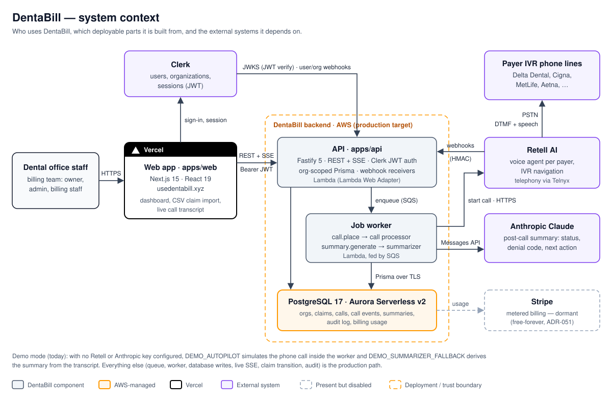
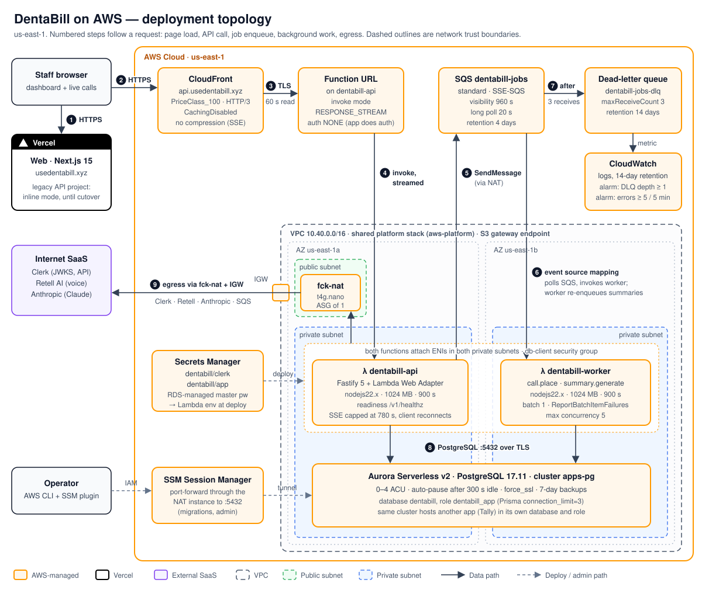
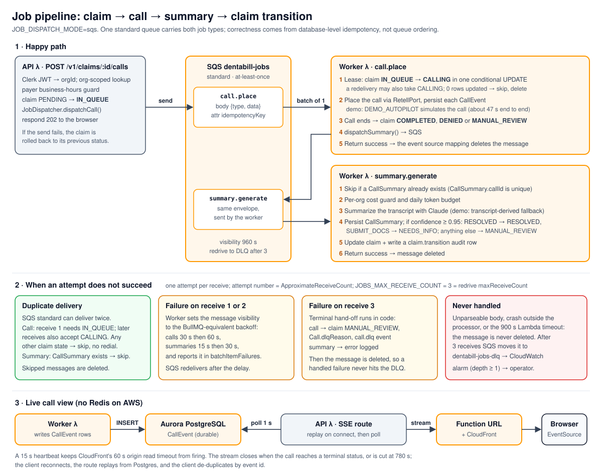
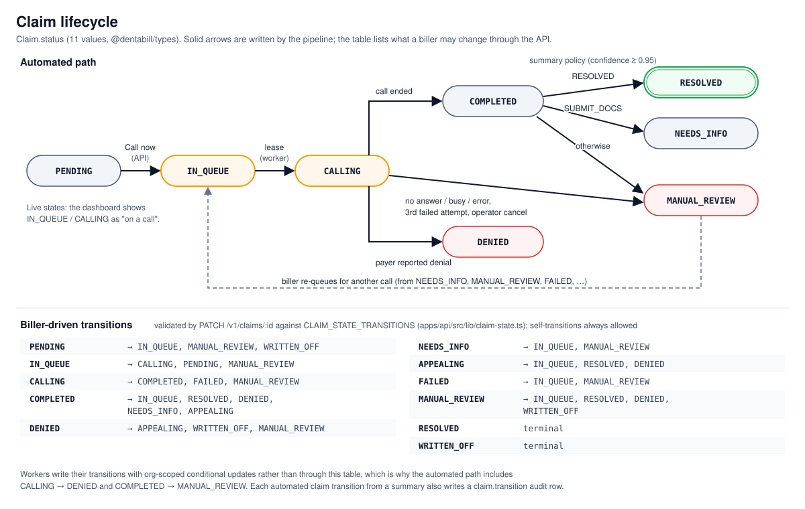

# DentaBill AI

> **Your insurance calls, handled.** A voice AI agent that calls dental
> insurance payers, navigates IVR systems, and returns structured claim
> status + next-action plans to dental billing teams.

## Status

Phases 1–4 are complete and the product runs end to end at
[dentabill.site](https://dentabill.site) in a disclosed **simulation mode**:
no payer is actually dialled (`DEMO_AUTOPILOT`) and summaries fall back to a
transcript-derived summarizer when no Anthropic key is set
(`DEMO_SUMMARIZER_FALLBACK`). Everything else (queue, worker, database, live
transcript, claim transition, audit) is the production path. The API is
moving from Vercel to AWS (branch `infra/aws`); `api.dentabill.site` still
points at Vercel until the DNS cutover. Real telephony is gated on the Retell
BAA, IVR tooling for the Retell agents, and wiring the call-duration and hold
guards (see [Failure modes](#failure-modes-and-resilience)). Roadmap:
`docs/PHASE_PLAN.md`, `PROGRESS.md`.

## Architecture

### Context and goals

Dental billing staff upload unpaid claims; DentaBill phones the insurance
payer, gets through the IVR, collects the claim status from the payer's IVR or
a representative, and turns the call into a structured next action. The
architecture is driven by five requirements:

1. **Long-running background work.** A payer call lasts minutes (hard cap 15 min,
   ADR-038), far longer than any HTTP request.
2. **Exactly-one effect under at-least-once delivery.** A claim must never be
   dialled twice or summarized twice, whatever the queue does.
3. **Tenant isolation for PHI.** Every read and write is scoped to the caller's
   organization, and PHI access is audited.
4. **Live feedback.** The dashboard streams the call transcript as it happens.
5. **Near-zero idle cost.** Usage is bursty and the business is pre-revenue
   (free-forever pivot, ADR-051).



DentaBill is a **modular monolith**: one TypeScript codebase with shared types
and one Postgres schema, deployed as separate units. The worker processors are
plain functions, so the same handlers run under BullMQ, inside the Vercel
function, or in a Lambda. `JOB_DISPATCH_MODE` selects which.

| Component             | Responsibility                                                                                                                                                                   | Runs on (AWS target)                        |
| --------------------- | -------------------------------------------------------------------------------------------------------------------------------------------------------------------------------- | ------------------------------------------- |
| `apps/web`            | Next.js 15 (App Router, RSC) marketing site and dashboard: claims, CSV import, live call view, reports, audit log. Clerk middleware and a nonce-based CSP.                       | Vercel                                      |
| `apps/api`            | Fastify 5 REST API with OpenAPI, Clerk JWT auth, the claim state machine, CSV ingest, SSE call stream, Retell, Clerk and Stripe webhooks. Also hosts the SQS worker entry point. | Lambda `dentabill-api` (+ Web Adapter)      |
| `apps/call-worker`    | `call.place` handler: takes the claim lease, places the call through `RetellPort`, persists `CallEvent`s, sets the outcome, and dispatches the summary. Also the DLQ escalation. | Lambda `dentabill-worker` (bundled via API) |
| `apps/summary-worker` | `summary.generate` handler: per-org token budget, Claude summary, `CallSummary`, transition policy, audit row.                                                                   | Lambda `dentabill-worker`                   |
| `apps/billing-worker` | Daily Stripe metered-usage reconciliation from the audit log.                                                                                                                    | Not deployed (billing dormant)              |
| `packages/db`         | Prisma schema and client; org-scope write guard, `getOrgScopedDb`, `audit()`.                                                                                                    | (library)                                   |
| `packages/queue`      | Job schemas and the `JobDispatcher` (BullMQ, inline, SQS).                                                                                                                       | (library)                                   |
| `packages/payer-ivr`  | Payer IVR maps, per-payer Retell agent prompts, `RetellPort` (live and fake), business-hours rules.                                                                              | (library)                                   |
| `packages/summarizer` | `SummarizerPort` (live Claude and fake); versioned prompts; output schema.                                                                                                       | (library)                                   |
| Postgres              | System of record: organizations, claims, calls, call events, summaries, audit log, billing usage.                                                                                | Aurora Serverless v2 (shared cluster)       |

### Deployment on AWS



Two Terraform stacks share one S3 state bucket: a **platform** stack in the
separate `aws-platform` repo (VPC, fck-nat, Aurora cluster, GitHub OIDC
provider), shared with a second app, and the **DentaBill** stack in
[`infra/aws/main.tf`](infra/aws/main.tf). A request takes this path:

1. The browser loads the Next.js app from Vercel and gets a Clerk session.
2. API calls go to CloudFront (`api.dentabill.site`) with the Clerk JWT. Caching
   and compression are off so SSE is not buffered.
3. CloudFront forwards over TLS to the Lambda Function URL, which runs in
   `RESPONSE_STREAM` mode.
4. The Lambda Web Adapter starts the unchanged Fastify server and proxies the
   invocation to it. The response streams back.
5. Enqueue routes `SendMessage` to `dentabill-jobs` (via the NAT).
6. The event source mapping invokes `dentabill-worker` with one message at a time
   (max concurrency 5).
7. A message that fails three receives is moved to `dentabill-jobs-dlq`, and a
   CloudWatch alarm fires.
8. Both functions reach Aurora on 5432 over TLS from private subnets.
9. All other egress (Clerk JWKS, Retell, Anthropic, the SQS API) leaves through
   the fck-nat instance. S3 is the only VPC endpoint.

### Job pipeline



Correctness lives in Postgres, not in the queue. `POST /v1/claims/:id/calls`
flips the claim to `IN_QUEUE` and sends `call.place`. The worker's first act is
a conditional update `IN_QUEUE → CALLING`. If that update matches zero rows, the
message is a duplicate or stale and is acknowledged without side effects. On a
redelivery (`ApproximateReceiveCount > 1`) `CALLING` is also accepted, so a
crashed attempt can be resumed. Summaries are idempotent on the unique
`CallSummary.callId`. Retries use the SQS message itself: on failure the worker
sets the message's visibility timeout to the BullMQ-equivalent backoff and
reports it in `batchItemFailures`. On the final receive it runs the terminal
hand-off in code (claim to `MANUAL_REVIEW`), so the DLQ only ever holds
messages the code never handled. Details: [`docs/DEPLOY_AWS.md`](docs/DEPLOY_AWS.md).



### Key design decisions

| Decision                                                   | Why                                                                                                                                                                                                                                                            | Trade-off accepted                                                                                                                                                                             |
| ---------------------------------------------------------- | -------------------------------------------------------------------------------------------------------------------------------------------------------------------------------------------------------------------------------------------------------------- | ---------------------------------------------------------------------------------------------------------------------------------------------------------------------------------------------- |
| **CloudFront + Lambda Function URL**, not API Gateway      | API Gateway's ~30 s integration timeout would cut SSE streams, which run up to 780 s. A Function URL in `RESPONSE_STREAM` mode streams for the full 15 min Lambda limit. CloudFront adds the custom domain, TLS 1.2+, HTTP/3, and a place to attach WAF later. | No API Gateway throttling, usage plans or request validation; rate limiting is in-app and per instance. The Function URL (auth `NONE`) is reachable directly, though Clerk auth still applies. |
| **Lambda Web Adapter** around the existing Fastify server  | The same server runs locally, on Vercel and on Lambda with no handler rewrite. Readiness is `/v1/healthz`.                                                                                                                                                     | One function serves every route, so scaling, memory and IAM are coarse. The adapter adds a little cold-start time.                                                                             |
| **SQS standard + DB-level idempotency**, not FIFO          | FIFO queues have no per-message delay (`DelaySeconds` is queue-wide), and their 5-minute dedupe window would not cover redeliveries anyway. Ordering is irrelevant. A DB lease is needed regardless, because the claim row is what must not double-transition. | At-least-once delivery means duplicates reach the worker; the lease absorbs them. SQS has no priority, so calls run in arrival order.                                                          |
| **One queue, batch size 1, max concurrency 5**             | Per-message failure isolation. The cap bounds DB connections (5 × `connection_limit=3`) and concurrent phone calls.                                                                                                                                            | Call and summary jobs share the concurrency budget, so a summary burst can delay dialling.                                                                                                     |
| **A whole call in one worker invocation**                  | Reuses the BullMQ handler unchanged, with no durable workflow engine to operate.                                                                                                                                                                               | Bounded by Lambda's 900 s limit; see the known limitation below.                                                                                                                               |
| **Aurora Serverless v2, 0 ACU auto-pause**, shared cluster | Pays almost nothing while idle (pauses after 300 s). Standard Postgres 17, so Prisma and migrations are unchanged. One cluster serves two apps, each with its own database and role.                                                                           | About 15 s resume on the first query after idle. One writer instance and no replica. Noisy-neighbour risk from the other app.                                                                  |
| **fck-nat** (t4g.nano, ASG of 1) instead of NAT Gateway    | A managed NAT Gateway costs ~$32/month plus data processing before any traffic. A nano instance costs a few dollars. It also hosts SSM port-forwarding to the database, so there is no bastion.                                                                | Single instance in one AZ. While the ASG replaces it, all egress stops, including SQS sends (no SQS interface endpoint). Throughput is limited.                                                |
| **Vercel for the Next.js frontend**                        | First-class Next.js (RSC, middleware, preview deploys) on a plan that is already paid for.                                                                                                                                                                     | Two providers. The API is cross-origin (CORS pinned to the app URL).                                                                                                                           |
| **No Redis on AWS**                                        | Removes the only always-on stateful service. SSE replays from Postgres and then polls `CallEvent` every second (ADR-053).                                                                                                                                      | About 1 query/s per open stream. The summary token budget is a soft cap per instance.                                                                                                          |

### Failure modes and resilience

| Failure                                       | Behaviour                                                                                                                                                                                                                                                                                                 |
| --------------------------------------------- | --------------------------------------------------------------------------------------------------------------------------------------------------------------------------------------------------------------------------------------------------------------------------------------------------------- |
| Aurora paused (idle > 300 s)                  | The first query waits about 15 s for resume. Prisma's `connect_timeout=30` / `pool_timeout=30` and CloudFront's 60 s origin read timeout absorb it. The user sees one slow request, not an error.                                                                                                         |
| Lambda cold start                             | The Web Adapter holds traffic until `/v1/healthz` answers. Expect a few seconds on the first request to a new instance.                                                                                                                                                                                   |
| Worker attempt throws                         | Retried via visibility timeout (calls 30 s, 60 s; summaries 15 s, 30 s), at most 3 receives.                                                                                                                                                                                                              |
| Final attempt fails                           | Call: claim moves to `MANUAL_REVIEW` with `Call.dlqReason` and a `call.dlq` event, so a biller sees it in the dashboard. Summary: logged.                                                                                                                                                                 |
| Poison message, crash, or Lambda timeout      | Never acknowledged. After 3 receives SQS moves it to the DLQ, and the `dentabill-jobs-dlq-not-empty` alarm fires.                                                                                                                                                                                         |
| Duplicate delivery                            | Absorbed by the `IN_QUEUE → CALLING` lease and the unique `CallSummary.callId`. Residual edge: a duplicate that arrives as a redelivery while the original call is still live can take the `CALLING` lease (see below).                                                                                   |
| SQS send fails at enqueue                     | The claim is rolled back to its previous status and the API returns an error, so nothing is left stuck `IN_QUEUE`.                                                                                                                                                                                        |
| **Call longer than 900 s** (known limitation) | The invocation dies and SQS redelivers after 960 s. The redelivery takes the `CALLING` lease and **dials again**. The duration and hold guards exist but are not wired yet, so they must be capped well under 900 s before real telephony ([`docs/DEPLOY_AWS.md`](docs/DEPLOY_AWS.md#known-limitations)). |
| SSE stream hits 780 s                         | The server cuts it, and the client reconnects, replays from Postgres and de-duplicates by event id. A 15 s heartbeat keeps CloudFront's 60 s read timeout from firing.                                                                                                                                    |
| NAT instance lost                             | The ASG replaces it in minutes. Meanwhile enqueue fails cleanly (rolled back) and worker egress fails into the retry path.                                                                                                                                                                                |
| AZ outage                                     | The Lambdas run in both private subnets. The NAT is only in us-east-1a, and Aurora has one writer, so a us-east-1a outage takes egress down until the instance is recreated elsewhere.                                                                                                                    |

### Security

- **Identity:** Clerk issues the session. The API verifies the JWT against Clerk's
  JWKS on every authenticated route and derives `orgId` from the token, never from
  the request body (ADR-024).
- **Tenant isolation, three layers (ADR-009):** a Prisma extension rejects writes
  to multi-tenant models without `organizationId`, `getOrgScopedDb(orgId)`
  injects the org filter into reads, and `audit()` records every PHI read. Workers
  re-validate job payloads at the queue boundary and go through the same scoped
  accessors.
- **Network:** both Lambdas and Aurora sit in private subnets with no inbound
  path. The Aurora security group admits 5432 only from the shared `db-client` group
  and the NAT instance (for SSM tunnels).
  There is no bastion host: admin access is SSM Session Manager port-forwarding,
  authorized by IAM.
- **Encryption:** TLS on every hop (viewer → CloudFront → Function URL, and
  Lambda → Aurora with `force_ssl`). SQS uses SSE-SQS, and Aurora storage is
  encrypted.
- **Secrets:** Clerk keys and app secrets (`DATABASE_URL`, `DOB_HASH_SECRET`,
  `RETELL_WEBHOOK_SECRET`) are stored in Secrets Manager (`dentabill/clerk`,
  `dentabill/app`), and the Aurora master password is RDS-managed. Today
  Terraform resolves them into Lambda environment variables at deploy time, so
  they also live in the encrypted state bucket. A runtime fetch through the
  Secrets Manager extension is the upgrade path.
- **Webhooks:** Retell and Stripe webhooks are HMAC-verified over the raw body
  with constant-time compare and replay protection (ADR-036). Clerk webhooks are
  Svix-verified.
- **CI credentials:** no long-lived AWS keys are stored anywhere. The GitHub OIDC
  provider exists in the platform stack, and CI deploys via an assumed role are
  planned. Applies are run by the owner today.

### Observability

- **Logs:** structured pino JSON with PHI-field redaction goes to CloudWatch Logs
  (14-day retention). Source maps are enabled, so stack traces point at
  TypeScript. Every job log line carries `messageId`, attempt and `jobId`.
- **Alarms:** DLQ depth ≥ 1, and Lambda `Errors` ≥ 5 in 5 min for each function.
  They have no notification target yet (SNS → email is the next step).
- **Health:** `/v1/healthz` (liveness, used by the adapter) and `/v1/readyz`
  (checks Postgres) for an external uptime monitor.
- **Audit trail:** the `AuditLog` table records claim transitions with summary id,
  confidence and prompt version. It is viewable in the dashboard.
- SLOs are defined in `docs/SLOS.md`. Sentry/tracing is deferred (ADR-007).

### Cost

The whole AWS platform runs at about **$12–18/month**, shared with a second
app. The fixed costs are the fck-nat instance and its public IPv4 address,
Aurora storage and backups plus ACU-hours while awake, and Secrets Manager.
Lambda, SQS, CloudFront and CloudWatch stay at or near free-tier levels at
current volume. Aurora's scale-to-zero and fck-nat are the two choices that
keep it there. A NAT Gateway, or Aurora with a 0.5 ACU floor, would each
more than double the bill.

### Environments

| Environment                  | Web        | API                                    | Jobs (`JOB_DISPATCH_MODE`)                                               | Database                | Live transcript  |
| ---------------------------- | ---------- | -------------------------------------- | ------------------------------------------------------------------------ | ----------------------- | ---------------- |
| Local (`docker compose`)     | `next dev` | Fastify process                        | `bullmq`: Redis + `call-worker` / `summary-worker` processes             | Postgres 16 (container) | Redis pub/sub    |
| Vercel (current / alternate) | Vercel     | One Vercel function (800 s, streaming) | `inline`: self-POST to `/v1/internal/jobs/*` under `waitUntil`, no queue | Neon                    | Postgres polling |
| **AWS (production target)**  | Vercel     | Lambda + Web Adapter behind CloudFront | `sqs`: SQS standard queue + worker Lambda, DLQ                           | Aurora Serverless v2    | Postgres polling |

Inline mode has no durable queue: a function that dies mid-job loses the job.
That is the main reason AWS is the production target.

**Further reading:** [`docs/DEPLOY_AWS.md`](docs/DEPLOY_AWS.md) (dispatch
modes, retries, env, build) · [`infra/aws/README.md`](infra/aws/README.md)
(Terraform and first-time DB setup) ·
[`docs/DEPLOY_VERCEL.md`](docs/DEPLOY_VERCEL.md) (serverless alternate) ·
`docs/ARCHITECTURE.md` (call lifecycle, package graph) ·
`docs/DECISIONS.md` (ADRs) · `docs/RUNBOOK.md`.

## Stack

Locked per `PRD.md` §2 and `docs/DECISIONS.md`. Highlights:

- Turborepo + pnpm workspaces (Node 20.19+; Lambda bundles target Node 22)
- TypeScript strict, Vitest (unit/integration), Playwright (e2e, visual, a11y)
- PostgreSQL (16 locally, 17 on Aurora) + Prisma v6 (multi-tenant, every query org-scoped)
- Fastify v5 API, Next.js 15 App Router + React 19, BullMQ or SQS job dispatch
- Retell AI + Telnyx (voice), Anthropic Claude (post-call analysis)
- Clerk auth, Resend mail, Stripe billing (dormant)
- Terraform (AWS provider 6) for `infra/aws`

## Quickstart (local dev)

Prerequisites: Node 20.19+, Docker Desktop / OrbStack running, Corepack-enabled pnpm.

```bash
# 1. Clone
git clone https://github.com/yash9657/dentabill.git
cd dentabill

# 2. Install (Node version is enforced via .nvmrc + engine-strict)
corepack enable pnpm                  # one-time, if pnpm isn't on PATH yet
pnpm install --frozen-lockfile

# 3. Configure env (do not edit .env.example — it stays as the template)
cp .env.example .env
# edit .env with real Clerk / Retell / etc. keys when those become needed

# 4. Boot Postgres + Redis locally
docker compose up -d
docker compose ps                     # both containers should be 'healthy'

# 5. Apply database schema
pnpm --filter @dentabill/db exec prisma migrate dev

# 6. Run the quality gate
pnpm turbo run typecheck lint test build

# 7. Boot dev servers (web, api, workers)
pnpm dev
```

## Daily commands

```bash
pnpm turbo run typecheck            # tsc --noEmit on all workspaces
pnpm turbo run lint                 # eslint
pnpm turbo run test                 # vitest
pnpm format                         # prettier --write .
pnpm format:check                   # prettier --check . (used in CI)
docker compose down                 # stop local services
docker compose down -v              # stop + drop volumes (full reset)
```

## Repository layout

```
apps/
  web/              Next.js 15 frontend (Vercel)
  api/              Fastify v5 REST API + SSE; Lambda server and SQS worker entry points
  call-worker/      call.place handler + DLQ escalation (BullMQ process locally)
  summary-worker/   summary.generate handler: Claude post-call analysis
  billing-worker/   Stripe metered-usage reconciliation (dormant)
packages/
  config/           Shared TS / ESLint / Prettier / Vitest config
  db/               Prisma schema + client, org-scope guard, audit()
  types/            Shared Zod schemas, enums, ApiError contract
  logger/           pino with PHI-field redaction
  queue/            Job schemas + JobDispatcher (BullMQ / inline / SQS)
  payer-ivr/        Payer IVR maps, Retell agents, RetellPort
  summarizer/       SummarizerPort (Claude / fake), prompts
  notifier/         Transactional email port (Resend / fake)
  billing/          BillingPort (Stripe / fake)
  api-sdk/          Typed client generated from the OpenAPI spec
  ui/               Shared shadcn/ui components
infra/aws/          Terraform for the AWS API stack
docs/               Phase plan, ADRs, deploy runbooks, architecture diagrams
.claude/            Claude Code agents/skills/hooks for this repo
```

See `docs/CODEMAP.md` for the navigable index (auto-maintained).

## Contributing

Read `CONTRIBUTING.md`. Short version: branch off `main` as
`phase-<n>/<short-slug>`, write Conventional Commits, run the quality gate
locally, complete the PR template (especially the Security / HIPAA section).

## Security

PHI handling is non-negotiable. Multi-tenant isolation, no PHI in logs,
audit log on PHI access. See `SECURITY.md` for vulnerability disclosure
and `docs/SECURITY.md` for the technical safeguards
inventory.

## License

Proprietary — all rights reserved. Not open source.
