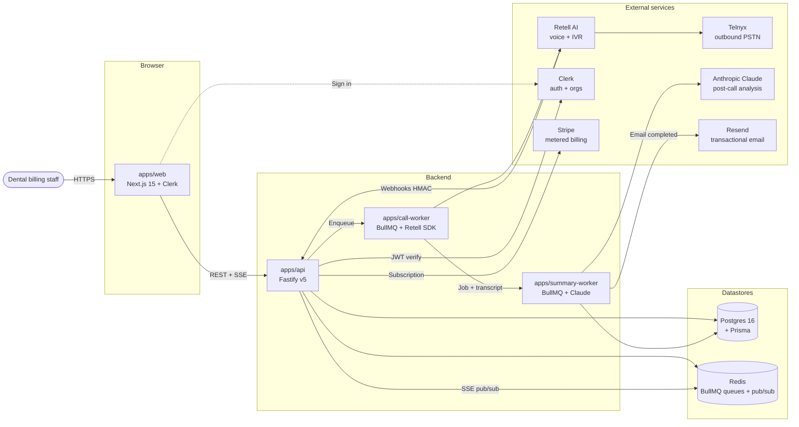
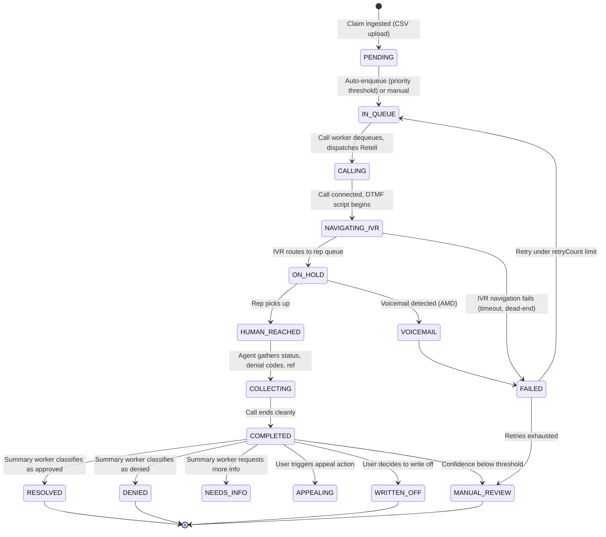
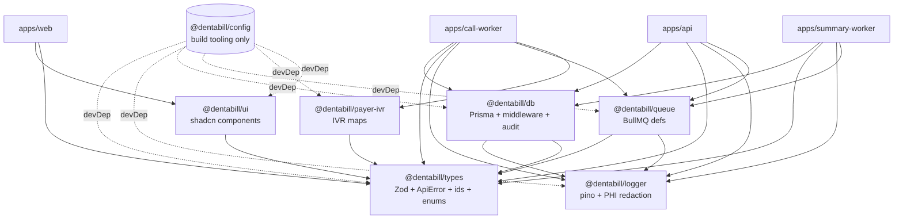

# Architecture

This is the long-form companion to `PRD.md` §3 and `docs/CODEMAP.md`. It describes
how the runtime services fit together, the call lifecycle, and where future
work is bound to land. Keep this file conceptual — for "what file lives where"
use `docs/CODEMAP.md`; for "what the engineering rules are" use
`docs/ENGINEERING_RULES.md`.

## Style: modular monolith, not microservices

DentaBill is a **modular monolith deployed as separate processes** — one
codebase, shared types and database, but separate deployment units. This
choice (per the technical-plan source document) is intentional:

- **Shared types** between Fastify API and BullMQ workers via `@dentabill/types`
  - Prisma client — no inter-service contracts to maintain.
- **Transactional integrity** — a failed call update and a failed audit-log
  write roll back together in one Postgres transaction.
- **Operational simplicity** — three processes to monitor (api,
  call-worker, summary-worker) vs eight microservices.
- **Easy to extract later** — each "service" already lives in its own
  `apps/<x>/` folder. Splitting one out is a build-time / deploy-time
  change, not a code rewrite.

## Process topology

**Cloud-target boundary** (per ADR-004) — Postgres, Redis, and the four
process containers are deploy-target-agnostic. The decision between
Railway and AWS lands in Phase 5; until then, each app is a vanilla
12-factor process with config from env vars and no provider SDKs in
application code.

## Call lifecycle

The state machine for a single claim → call → resolution. Each transition
is recorded as a `CallEvent` row for debugging, plus an `AuditLog` entry
for any PHI-touching read.

Status enum values are defined once in `@dentabill/types` (`CLAIM_STATUS_VALUES`,
`CALL_STATUS_VALUES`) and re-exported from `@dentabill/db` once Prisma
generates them.

## Package topology

Internal package dependency graph. Cycles are forbidden; `eslint-plugin-import`
catches them in CI.

## Real-time updates

When a call's state changes, the dashboard updates within ~2 seconds without
a page refresh. The path:

1. The call worker writes the state update to Redis pub/sub channel
   `org:{orgId}:calls`.
2. The API server subscribes to Redis pub/sub.
3. The API holds an SSE connection per authenticated dashboard session.
4. On a Redis message, the API forwards the event to all SSE connections
   for that org.
5. The Next.js client uses `EventSource` to receive events and updates the
   React Query cache, which re-renders.

SSE is preferred over WebSockets here: unidirectional, simpler proxy/load
balancer compatibility, native to HTTP/2. Lands in Phase 4.

## Concurrency model

Each outbound call is a BullMQ job. BullMQ supports thousands of concurrent
jobs via Redis. The call-worker process runs N workers; each worker handles
M concurrent calls. Workers are stateless — any worker can take any job —
so scale is "add another container".

When the deploy target is decided (ADR-004), auto-scaling will trigger on
queue depth (BullMQ exposes a CloudWatch / Railway metric).

## Migration to microservices (later, if needed)

If a single component requires independent scaling (typical candidate:
the call-worker pool when Retell concurrency is bottlenecking), the
extraction is mechanical because:

- `apps/call-worker` already imports only `@dentabill/db`, `@dentabill/queue`,
  `@dentabill/payer-ivr`, `@dentabill/types`, `@dentabill/logger`.
- Splitting it out means: keep the same code, deploy as a separate service,
  and replace the in-process Prisma client with HTTP calls to a new
  `claim-service` if database isolation is also needed.

Deferred — unwarranted at Phase 1–4 scale.
