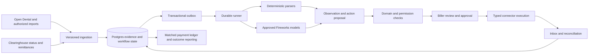

# DentaBill: competitive gaps and the Fireworks implementation plan

> Implementation update, 2026-10-13: FW-10–13 now provides a local typed Fireworks text gateway,
> reviewed release gating, source-bound observations and bounded transport (ADR-063). No model
> is approved or selected by production jobs. FW-26 adds durable synthetic inference ownership
> (ADR-064), FW-41 adds awaited native per-send admission/receipts and crash recovery (ADR-065),
> and FW-27 adds immutable findings/reviews (ADR-066) and explicitly approved same-call
> regeneration with durable recovery (ADR-067), plus explicit automatic native job routing and
> visible post-call status (ADR-068), all local and disabled by default.
> Notification outbox (FW-40), live model
> evaluation and provider approval remain open.
> Fireworks/ElevenLabs credentials are now present locally. FW-37 adds scoped operations and audited delivery
> recovery (ADR-062); current Fireworks gateway requirements are in FIREWORKS_GATEWAY_CONTRACT.md.
> FW-36 has local persisted accepted-call observation,
> duration/Stop confirmation state and synthetic separate-process recovery evidence; FW-38
> allowlists Prisma diagnostic output. Latest implementation/test/release limits are recorded
> in SESSION_CONTEXT.md, PROVIDER_EVIDENCE.md and ADR-061. These local changes are not deployed
> parity or authorized clinic/provider evidence. The remaining backlog below stays in scope.

**Research and repository audit:** 2026-10-12. **Baseline:** commit `25e82a7`.
**Status:** implementation proposal; no application code, deployment, vendor contract, or production setting was changed by this audit.

> **Execution update — 2026-10-13:** the audit below is preserved as its original
> planning baseline. [SESSION_CONTEXT.md](./SESSION_CONTEXT.md) and
> [PROVIDER_EVIDENCE.md](./PROVIDER_EVIDENCE.md) now track actual implementation and
> current evidence. ADR-055 permits ElevenLabs speech/orchestration, with Fireworks
> business inference; AWS Lambda/SQS/Aurora supersedes the old Vercel-only assumption.
> Actual configured telephony is Retell-managed Twilio; Telnyx is a candidate, not a
> verified existing carrier. User has no clinic yet and requests fake patient data.
> Local containment fixes, call-intent submission fencing and synthetic worker-crash
> tests do not establish full production parity. Transactional call/summary delivery and
> pending cancellation are locally implemented (ADR-059). Owner/admin positive-only Retell
> reconciliation now saves source evidence and durable resume work (ADR-060), with synthetic
> crash/race proof. Account sweeps, persisted deadlines, quarantine operations and deployed
> recovery remain open; no actual-provider compatibility claim follows from fixtures.

## 1. The blunt assessment

DentaBill has a credible application foundation and a demonstrated **simulated call → summary → status update** workflow. It does not yet have a demonstrated insurance-recovery operation. Its present architecture can confuse a model's opinion with claim resolution and a resolved claim's face value with money recovered. Those are product-trust failures, not cosmetic gaps.

Replacing Claude with a Fireworks endpoint is necessary to meet the new model requirement, but insufficient to make this industry grade. The larger job is building reliable integrations, a dental financial model, evidence-backed actions, durable execution, payment reconciliation, and a biller's exception workflow.

**Recommended first product:** an evidence-backed accounts-receivable workbench for small US dental practices using Open Dental, initially covering three explicitly enrolled payer/product/region combinations. Read claim status and remittances electronically first; generate reviewable next actions; escalate to a phone call only when needed and when the entire Fireworks voice chain is proven. Start with two or three design partners. This customer segment is a planning assumption, not a user-confirmed commercial decision.

**Do not sell autonomous recovery yet.** A polished claims dashboard, synthetic transcripts, passing unit tests, and working demo calls do not establish real payer navigation, correct adjudication, successful resubmission, or collected cash.

### What deserves to survive

- The TypeScript monorepo, Fastify API, Next.js application, Prisma schema/migrations, and explicit adapter boundaries.
- Clerk organization context, scoped database access, write middleware, audit records, and existing tenant tests.
- CSV normalization for several dental systems, call timelines, persisted events, SSE replay, and the honest simulation mode.
- BullMQ support, fake adapters, and useful existing unit/integration tests. These are a starting point for contract and failure testing, not evidence to discard the repository.

### Evidence and limits

**Confirmed in code** means the implementation inspected at the baseline. **Reproduced** means a local synthetic execution confirmed it. **Vendor claim** means a public statement, not independently audited performance. **Unknown** means no deployment/account/contract evidence was inspected.

This review did not inspect production data, credentials, signed BAAs, a live payer conversation, actual remittances, or a running deployment. Absence from the repository is not proof that an operational control or commercial agreement does not exist. Historical documents describe different dates and deployments; ADR-053 is newer than the August handoff.

## 2. What Lunabill actually sets as the benchmark

Lunabill publicly positions a broad AR service: portal-first work, phone escalation through IVRs and holds, eligibility checks, appeals with records, corrected claims, and remittance posting with EHR notes. It targets hospitals and RCM organizations and names medical EHR/clearinghouse integrations. Its commercial offer ties fees to collections. These are vendor claims and a different customer segment from a small dental practice. [Lunabill product](https://lunabill.com/)

Its Nutex case study reports 24 campuses, over $32 million of AR worked in 30 days, a reduction from 45 to seven AR days for the reported cohort, and four rather than 22 staff minutes per claim. **AR worked is not cash collected.** The case study is vendor-authored, with a particular customer and denominator; these numbers are not a validated dental forecast or an appropriate launch promise. [Nutex case study](https://lunabill.com/case-study/)

The resulting gaps are concrete:

1. **Getting work into the system:** DentaBill imports CSV snapshots. A recovery service needs recurring source-system sync, payer identifiers, claim lines, changes, and reconciliation.
2. **Choosing a channel:** DentaBill centers on initiating a call. A recovery service uses the cheapest reliable authorized channel and records why it escalated.
3. **Completing the work:** DentaBill produces a summary and proposed status. A recovery service obtains missing evidence, drafts or submits a correction/appeal, captures acknowledgement, and follows through.
4. **Closing the financial loop:** DentaBill counts resolved face value. A recovery service matches actual payments, adjustments, reversals, and remaining balances.
5. **Running exceptions:** DentaBill has a claim detail page and timeline. A recovery service needs ownership, deadlines, approval queues, evidence inspection, and clear handoff to a biller.
6. **Proving performance:** DentaBill has engineering tests and a demo. A recovery service needs measured factual accuracy, live completion rates, operational reliability, and attributable financial outcomes.

Dental specialization alone is not differentiation. DentalXChange already advertises claim, eligibility, attachment, payment, and reconciliation APIs; Zuub markets dental eligibility and claims-visibility infrastructure. Evaluate these as possible data/connectivity partners and competitors, rather than recreating every payer connection. Their public products do not prove coverage, commercial terms, permission to automate, or compliance for our intended use. [DentalXChange developer portal](https://developer.dentalxchange.com/claim-api), [Zuub](https://zuub.com/)

The defensible asset would be **correct dental workflows tied to verified outcomes**: which evidence resolves which denial under which plan, how much human effort it saves, and whether the money actually posts. A generic calling agent and a dental-themed interface are not that asset.

## 3. Ranked findings

P0 means block the affected production behavior. P1 means required for a credible narrow pilot. P2 means expansion after that pilot. File line numbers are baseline anchors and will move as implementation proceeds.

### G01 · P0 · “Recovered” does not mean recovered

**Confirmed:** `/v1/calls/stats` sums `claimAmount` for claims with status `RESOLVED`; reports do the same using claim modification time. The payer report iterates calls and adds the resolved claim's full amount for each call, so repeated calls can count the same amount repeatedly. There is no remittance/payment ledger to substantiate the metric.

Evidence: [calls.ts:678](/Users/yashbhalgat/code/dentabill/apps/api/src/routes/v1/calls.ts:678), [reports.ts:82](/Users/yashbhalgat/code/dentabill/apps/api/src/routes/v1/reports.ts:82), [reports.ts:175](/Users/yashbhalgat/code/dentabill/apps/api/src/routes/v1/reports.ts:175).

**Impact:** the headline business outcome can be wrong even when every request succeeds. A paid claim for $100 against $300 billed is not $300 recovered. Two calls do not create two payments.

**Fix:** immediately rename or suppress unsupported recovery metrics, separate completed calls from resolved claims, and add a reconciled ledger before restoring financial labels. Never infer historic payments from `RESOLVED` during migration. See W0/W3/W7.

### G02 · P0 · Model confidence can close a claim

**Confirmed:** when `SUMMARIZER_AUTO_TRANSITION_ENABLED` is enabled, `applyTransitionPolicy` permits a `RESOLVED` transition using the model's requested action and confidence threshold. The flag defaults to false; its live value was not inspected. The policy's current-status input is not used to protect transitions, including the manual-review fallback. There is no independent payment evidence requirement or calibrated risk estimate.

Evidence: [summary handler:439](/Users/yashbhalgat/code/dentabill/apps/summary-worker/src/handler.ts:439).

**Impact:** a plausible but wrong summary can remove work from the queue. A payer saying “processed” or “payment pending” must not silently become settled cash.

**Fix:** disable this automatic financial closure for real work. Emit an observation and action proposal; deterministic policy checks evidence, claim version, and permissions. “Payer reports paid,” “payment matched,” and “case closed” become different states. See W0/W3/W4.

### G03 · P0 · The live webhook schema does not match the documented provider envelope

**Reproduced:** the parser expects `{eventId, deliveredAt, event: {...}}`. Retell documents an envelope shaped like `{event: "call_ended", call: {...}}`. The API passes the parsed request directly to the internal-envelope parser. A synthetic documented-shape payload was rejected with required-field/type errors. The signing contract test does not test this payload shape.

Evidence: [events.ts:104](/Users/yashbhalgat/code/dentabill/packages/payer-ivr/src/retell/events.ts:104), [retell-webhook.ts:90](/Users/yashbhalgat/code/dentabill/apps/api/src/routes/v1/retell-webhook.ts:90), [Retell webhook documentation](https://docs.retellai.com/features/webhook-overview).

**Fix:** normalize authenticated raw provider payloads into versioned internal events, with recorded real-contract fixtures and an inbox. Because the intended stack is now Fireworks, keep this a bounded containment fix only if maintaining Retell during migration; do not build an extensive new Retell feature set. The same external-contract requirement applies to the replacement carrier. See W0/W2/W6.

### G04 · P0 · A webhook received by the API does not reliably finish a worker's call

**Confirmed:** `LiveRetell.subscribe` uses an in-process listener map. `waitForCallEnd` subscribes to that adapter; it polls cancellation but not terminal database events. The webhook persists/publishes events through another process. There is no implemented bridge into that worker-local subscription. Hold/duration/navigation helpers exist but are not wired into the live handler's execution path.

Evidence: [live.ts:125](/Users/yashbhalgat/code/dentabill/packages/payer-ivr/src/retell/live.ts:125), [handler.ts:367](/Users/yashbhalgat/code/dentabill/apps/call-worker/src/handler.ts:367).

**Impact:** a completed external call can leave an internal job waiting. A passing in-process fake does not test this topology.

**Fix:** durable state/event consumption, terminal deadlines, restart reconciliation, cancellation acknowledgement, and a verified provider hang-up contract. Prove the API and worker in separate processes. See W2/W6.

### G05 · P0 · Call initiation has a duplicate-side-effect window

**Confirmed:** the handler changes status, starts the external call, then creates the database `Call`. A crash or ambiguous timeout after external acceptance can lead to another start attempt. The live adapter's metadata idempotency key does not establish vendor-enforced idempotency. Inline mode has a claim lease that reduces duplicate triggers; it does not solve the external-call/DB gap or durable recovery.

Evidence: [handler.ts:143](/Users/yashbhalgat/code/dentabill/apps/call-worker/src/handler.ts:143), [inline-jobs.ts:150](/Users/yashbhalgat/code/dentabill/apps/api/src/lib/inline-jobs.ts:150).

**Fix:** create an action intent before dispatch, assign a stable operation identifier, enforce local uniqueness, and use confirmed upstream idempotency where available. On an unknown external result, reconcile first; never blindly redial. See W2.

### G06 · P0 · Delivery deduplication is not atomic business processing

**Confirmed:** webhook replay protection records the delivery before subsequent business processing. An unknown call can be acknowledged and ignored; a crash after the marker can make a future delivery look already processed. The summary handler separately creates a unique summary, updates the claim, writes audit, and records usage. A retry after partial success can collide on the unique summary while downstream work is missing. Inline mode's existing-summary shortcut can also skip incomplete downstream processing.

Evidence: [retell-webhook.ts:101](/Users/yashbhalgat/code/dentabill/apps/api/src/routes/v1/retell-webhook.ts:101), [summary handler:255](/Users/yashbhalgat/code/dentabill/apps/summary-worker/src/handler.ts:255), [inline-jobs.ts](/Users/yashbhalgat/code/dentabill/apps/api/src/lib/inline-jobs.ts).

**Fix:** inbox states `received/processing/applied/failed`, atomic local state+audit+outbox commits, unique business-operation keys, and separate idempotent usage accounting. Retain and retry early/out-of-order events. See W2/W4.

### G07 · P1 · The denial-code reference contains incorrect semantics

**Confirmed against the code authority:** a source comment describes RARC N370 as a missing-tooth exclusion. X12 identifies it as a rental-month limit issue. That comment is not an executable mapping, and this audit did not establish a model acted on it. The runtime checks membership in a small code allowlist, not whether an interpretation is correct; valid unfamiliar codes also fail the schema. The prompt says it enumerates permitted codes, but does not actually include that enumeration.

Evidence: [denial-codes.ts:47](/Users/yashbhalgat/code/dentabill/packages/payer-ivr/src/denial-codes.ts:47), [X12 RARC list](https://x12.org/codes/remittance-advice-remark-codes).

**Impact:** the domain reference is unreliable, code coverage is narrow, and schema validity offers no assurance that a recommendation interprets a code correctly. There is no verified production error rate for this behavior.

**Fix:** preserve raw codes with their actual code system, adjustment group, version, source, and cited explanation. Distinguish CARC, RARC, claim status, and payer-local messages. Unmapped valid codes trigger review; they are not automatically hallucinations. Review the entire existing list, not just N370. See W0/W3/W5.

### G08 · P1 · The schema cannot represent a normal complicated dental claim

**Confirmed:** `Claim` stores a flat CDT list and claim-level amount/status. It has no first-class procedure lines with tooth/surface/quadrant, coverage sequence, line adjudication, attachments, denial episodes, or financial events. A user belongs to one organization in the current schema, limiting future agency/DSO operation.

Evidence: [schema.prisma:134](/Users/yashbhalgat/code/dentabill/packages/db/prisma/schema.prisma:134).

**Fix:** build the domain model in §6. Partial payment, one denied line among several paid lines, secondary insurance, deductible/annual maximum, alternate benefit, and a reversal must be explicit fixtures. Membership/location expansion is P2 for the proposed small-practice pilot. See W3.

### G09 · P0 · Missing identity is replaced by a different identifier

**Confirmed:** the call input uses `subscriberId ?? claimNumber`. A claim number is not a subscriber ID. The stored DOB hash/year cannot reconstruct a DOB when a payer legitimately requires it.

Evidence: [handler.ts:317](/Users/yashbhalgat/code/dentabill/apps/call-worker/src/handler.ts:317), [schema.prisma:149](/Users/yashbhalgat/code/dentabill/packages/db/prisma/schema.prisma:149).

**Fix:** payer-specific required-data validation before scheduling; obtain missing fields from the authorized PMS or a narrowly scoped encrypted vault. Stop and route to a biller if unavailable. Never synthesize identity fields. Hashing one field does not make the surrounding record de-identified. See W3/W6/W8.

### G10 · P1 · CSV ingestion is neither a sync engine nor a database uniqueness guarantee

**Confirmed:** ingestion checks existing records then inserts chunks. The schema does not enforce the needed composite source identity, same-batch/concurrent duplicates can escape the precheck, and the implementation does not match its transaction comment. Reimports skip existing claims rather than reconciling updates.

Evidence: [insert.ts:30](/Users/yashbhalgat/code/dentabill/apps/api/src/lib/csv/insert.ts:30), [schema.prisma:149](/Users/yashbhalgat/code/dentabill/packages/db/prisma/schema.prisma:149).

**Fix:** unique `(organization, source, source-location, external-claim-id)` identity, previewed import differences, source revision tracking, resumable cursors, and tested conflict policies. Claim number alone is not a safe global identity. See W3.

### G11 · P1 · A callback date does not schedule follow-up

**Confirmed:** summaries can store `callbackDate`; the schema has `nextCallAt`. The audit found no production scheduler implementing the required future follow-up loop. Reports and timelines cannot substitute for durable timers, ownership, and deadline escalation.

Evidence: [summary handler:266](/Users/yashbhalgat/code/dentabill/apps/summary-worker/src/handler.ts:266), [schema.prisma:168](/Users/yashbhalgat/code/dentabill/packages/db/prisma/schema.prisma:168).

**Fix:** durable tasks with due time, local payer time zone, business calendar, owner, reason, attempt budget, and escalation. A vague “call next week” becomes a reviewable interpretation, not an unqualified filing deadline. See W2/W4.

### G12 · P0 for live autonomy · The zero-extra-hosting demo topology is not a durable workflow engine

**Confirmed:** ADR-053 explicitly accepts nonpersisted inline jobs and a 760-second execution budget. An invocation can disappear mid-job; the cost cap is process-local without Redis. These tradeoffs are documented, not hidden defects.

Evidence: [ADR-053](/Users/yashbhalgat/code/dentabill/docs/DECISIONS.md), [inline.ts](/Users/yashbhalgat/code/dentabill/packages/queue/src/inline.ts), [inline-jobs.ts:45](/Users/yashbhalgat/code/dentabill/apps/api/src/lib/inline-jobs.ts:45).

**Fix:** preserve inline mode for the disclosed demo. Production requires a durable runner: existing BullMQ workers plus persistent state is the lowest-code-change option; a durable service compatible with the existing hosting platform is another candidate if it passes the same recovery tests. ADR-053's no-extra-hosting-spend constraint has not been silently revoked. If no durable option fits the budget, autonomous live execution remains blocked. See W2/W8.

### G13 · P1 · The UI shows results but does not manage the work

**Confirmed:** claim details emphasize summary, status, Call Now, and timeline. There is no complete evidence review/action approval flow, task ownership, deadline inbox, document-request loop, or appeal/correction workbench. Integrations remain CSV-oriented.

Evidence: [claim-detail-page.tsx:95](/Users/yashbhalgat/code/dentabill/apps/web/src/components/dashboard/claims/claim-detail-page.tsx:95), [dashboard settings](/Users/yashbhalgat/code/dentabill/apps/web/src/app/dashboard/settings).

**Fix:** implement the review workflow in §8 before more autonomous features. See W4.

### G14 · P1 · The AI quality evidence is too shallow

**Confirmed:** the summarizer has useful schema checks and test fixtures, but no representative payer/practice evaluation corpus, calibrated action thresholds, source-level citations, model-release gate, or production drift measurement. A short hardcoded denial list is not retrieval. Prompt/tool correctness does not establish clinical-document or billing accuracy.

Evidence: [summarizer package](/Users/yashbhalgat/code/dentabill/packages/summarizer/src), [prompt v1](/Users/yashbhalgat/code/dentabill/packages/summarizer/src/prompts/v1.ts).

**Fix:** evidence-first extraction, deterministic checks, versioned policy retrieval, adversarial fixtures, domain adjudication, and stratified evaluation. See W1/W5/W8.

### G15 · P1 · A crashed budget lock can disable an organization for a day

**Confirmed:** the Redis summary lock has a 24-hour TTL and spans external work. Budget enforcement does not reserve the worst-case pending request spend. Inline mode weakens the cap across instances.

Evidence: [cost-guard.ts](/Users/yashbhalgat/code/dentabill/apps/summary-worker/src/cost-guard.ts), [summary handler](/Users/yashbhalgat/code/dentabill/apps/summary-worker/src/handler.ts).

**Fix:** short renewable leases with fencing where mutual exclusion is necessary; atomic budget reservations and settlement with unknown-cost reconciliation. Track input, cached input, output, audio, and failed attempts separately. See W1/W2.

### G16 · P1 · Security assertions outpace the evidence available in the repository

**Confirmed copy; operational state unknown:** marketing refers to recording encryption/retention and SOC 2 progress. No reviewed vendor contracts or independent audit evidence were available in this audit. Security documentation ties BAAs to paying customers; the relevant boundary is processing PHI, including an unpaid pilot. Tenant defenses exist, but require tests covering parent-child lookups, events, exports, documents, and retrieval.

Evidence: [security page](</Users/yashbhalgat/code/dentabill/apps/web/src/app/(marketing)/security/page.tsx>), [SECURITY.md](/Users/yashbhalgat/code/dentabill/docs/SECURITY.md).

**Fix:** verify each public claim against an owner-maintained evidence register; remove or qualify unsupported statements. Inventory actual PHI processors and subprocessors, obtain required agreements before PHI, and prove lifecycle and tenant boundaries. No claim of “HIPAA certification” should replace those controls. See W8.

### G17 · P1 · There is no measured business or operating model

**Confirmed gap:** free-forever positioning coexists with paid inference, telephony, operations, and human review. There is no verified unit economics ledger or accepted pilot success denominator. This audit does not change the pricing decision.

**Fix:** explicitly fund and cap the pilot; measure cost per eligible case, completed action, and reconciled dollar, including human minutes. Decide commercial policy separately with real data. See §11.

### G18 · P0 decision gate · “Fireworks for everything” does not yet have a proven voice implementation

**Verified public limitation of the evidence:** current audio-input documentation describes multimodal input and text output; it does not establish a complete streaming ASR + speech-generation + telephony stack. Older transcription announcements and customer stories are not current endpoint/SLA/license contracts. No verified generally available Fireworks TTS endpoint was established by this research.

**Fix:** run the bounded feasibility gate in §5. The architecture must satisfy the user's strict requirement; an undisclosed third-party TTS or ASR fallback is not an acceptable shortcut. See W0/W6. [Fireworks audio/video documentation](https://docs.fireworks.ai/guides/video-audio-inputs)

## 4. Current domain research that changes the design

### Dental data and standards are versioned, licensed inputs

CDT is updated annually. CDT 2027 materials were announced in 2026 for codes effective January 1, 2027. Apply the code set appropriate to date of service; do not reinterpret an old claim using the newest labels. Commercial software use of CDT content requires an appropriate ADA license. Record licensed scope and permitted uses before distributing descriptions or using them in retrieval. [ADA CDT](https://www.ada.org/publications/cdt), [ADA 2027 announcement](https://adanews.ada.org/ada-news/2026/june/cdt-2027-available-for-preorder-through-ada-store/), [ADA commercial licensing](https://www.ada.org/publications/ada-store-products/licensing-for-commercial-users)

X12's April 2026 AI guidance distinguishes permitted private grounding under applicable licenses from model training; its commercial license does not authorize training on the standards. An open-weight model and zero-retention inference do not waive content licenses. Confirm that the chosen hosted topology and use satisfy the actual license. Keep proprietary standards out of fine-tuning datasets unless separately authorized. [X12 AI guidance](https://x12.org/news-and-events/news/using-ai-x12-standards-whats-allowed-whats-not-and-why-it-matters)

A code's existence does not establish coverage. Benefits, plan rules, contracts, coordination of benefits, and clinical documentation determine the workflow. Model these as distinct evidence sources with applicable dates. Do not let a generated narrative manufacture medical necessity or services. [ADA plan participation guidance](https://www.ada.org/resources/practice/dental-insurance/participating-in-a-plan)

### Electronic transactions come before browser robots and calls

Build around the applicable dental transactions: 837D claims, 270/271 eligibility, 276/277 status, and 835 remittance. Distinguish a claim acceptance acknowledgement from adjudication and a remittance from bank settlement. Confirm implementation versions and payer support with the contracted clearinghouse. [CMS transaction overview](https://www.cms.gov/Outreach-and-Education/MLN/WBT/MLN4462429-MLN-WBT-1500/1500/lesson03/11/index.html)

CMS's March 2026 claims-attachment final rule adopts attachment transaction/signature standards, with an effective date of May 26, 2026 and a 24-month compliance period. The fact sheet distinguishes claims attachments from prior-authorization attachments, which were not finalized there. Design versioned attachment adapters, but do not assume every dental payer supports the new transaction today or infer blanket dental applicability from the fact sheet alone. Validate applicability with the trading partner and counsel. [CMS final-rule fact sheet](https://www.cms.gov/newsroom/fact-sheets/administrative-simplification-adoption-standards-health-care-claims-attachments-transactions)

Open Dental exposes claim and procedure-level insurance-payment APIs. Payment writeback is consequential: claim-procedure edits can affect income transfers and recalculation. Begin read-only, then reviewed notes, then a separately gated payment-posting workflow. Its API authorization model must be handled explicitly; ordinary desktop-user restrictions are not a sufficient app authorization boundary. [Claims API](https://www.opendental.com/site/apiclaims.html), [ClaimProcs API](https://www.opendental.com/site/apiclaimprocs.html), [API permissions](https://www.opendental.com/site/apipermissions.html), [Setup requirements](https://www.opendental.com/site/apisetup.html)

### Compliance and agent safety are architecture inputs

HHS explains that a cloud provider handling ePHI can be a business associate even when it cannot decrypt the data. Review each actual PHI data flow, including backups, logging, inference, voice, storage, and observability. Obtain the appropriate contracts and conduct the risk analysis before real PHI enters that flow. A public HIPAA-support page does not establish coverage for our account. [HHS cloud guidance](https://www.hhs.gov/hipaa/for-professionals/special-topics/health-information-technology/cloud-computing/index.html)

The FCC has confirmed that AI-generated voices fall within the artificial/prerecorded-voice framework. The precise obligations depend on the destination, consent, exemptions, and use; this does not establish that every business-to-business payer call is prohibited. Obtain a reviewed dialing/recording/disclosure policy for the actual target lines and jurisdictions. [FCC ruling](https://docs.fcc.gov/public/attachments/FCC-24-17A1.pdf)

An EOB, transcript, payer portal, or retrieved policy can contain malicious instructions. Treat these as untrusted evidence. The model must never choose its own tenant, credentials, network destination, or write permissions. Limit tools and require external policy checks for consequential actions. [OWASP excessive agency](https://genai.owasp.org/llmrisk/llm062025-excessive-agency/)

## 5. Fireworks architecture and model-selection plan

### Non-negotiable boundary

All model inference must use approved **open-weight models hosted by Fireworks**: extraction, reasoning, document vision, embeddings, reranking, any model-based evaluation, and voice inference if available. Deterministic parsers, database queries, a telephony carrier, and human review are not model providers. A partner API that silently adds its own AI interpretation requires separate provenance diligence.

Do not leave an Anthropic production fallback. Do not use a mixed-provider automatic router that can select a closed-weight model. Official model-specific US routes are allowed only after verifying their model/deployment policy; a path containing `routers` is not by itself disqualifying. Rollback means returning to a previously approved Fireworks release or to manual review.

### Initial bake-off, not a premature model winner

The current Fireworks recommended-model catalog includes newer families than several older marketing pages. Treat these as candidates and pin a tested release; do not select solely from a leaderboard. [Current model guidance](https://docs.fireworks.ai/guides/recommended-models)

- **Default extraction and document understanding candidate: GLM 5.3 Flash.** Fireworks model ID `accounts/fireworks/models/glm-5p3-flash`. Its model page lists vision/function calling; the publisher supplies MIT-licensed weights. Benchmark noisy transcripts, EOB tables, negations, and identifier fidelity before adoption. [Fireworks model card](https://app.fireworks.ai/models/fireworks/glm-5p3-flash), [publisher weights/license](https://huggingface.co/zai-org/GLM-5.3-Flash)
- **Independent challenger: DeepSeek V4.1 Flash.** ID `accounts/fireworks/models/deepseek-v4p1-flash`, with publisher MIT weights. Use as a benchmark and bounded escalation candidate; two models agreeing does not independently validate an unsupported fact. [Fireworks model card](https://app.fireworks.ai/models/fireworks/deepseek-v4p1-flash), [publisher weights/license](https://huggingface.co/deepseek-ai/DeepSeek-V4.1-Flash)
- **Difficult-case candidates:** GLM 5.3 and Kimi K3, subject to license, latency, region, and quality checks. Reserve for evidence-heavy drafting/reconciliation reasoning if they improve the evaluation frontier. Do not put expensive reasoning in every conversational turn.
- **Retrieval candidates:** Qwen3 Embedding 8B and Qwen3 Reranker 8B. Fireworks lists serverless identifiers `fireworks/qwen3-embedding-8b` and `fireworks/qwen3-reranker-8b`; these API identifiers are not interchangeable with chat identifiers. Confirm the precise publisher license and deployment region before release. Embeddings are unnormalized: use cosine distance or explicitly normalize. Do not substitute a proprietary embedding service merely because it appears in the same catalog. [Embedding/reranking documentation](https://docs.fireworks.ai/guides/querying-embeddings-models)

**Proposed US policy:** for supported chat models use `https://us.api.fireworks.ai/inference/v1` and the documented model-specific US IDs, such as `accounts/fireworks/routers/glm-5p3-flash-us` and `accounts/fireworks/routers/deepseek-v4p1-flash-us`. Verify the underlying revision/quantization and change policy with Fireworks. Confirm separate region availability for embeddings, reranking, and audio; chat availability does not prove those. US-only processing is our proposed product policy, not a universal HIPAA locality rule. [US-only documentation](https://docs.fireworks.ai/serverless/us-only-serverless)

### Privacy and account configuration

Fireworks documents no persistent input/output retention by default for open models, with exceptions for opted-in features and separate treatment of metadata and volatile caching. Its Responses API can retain conversation state by default; use stateless chat completions initially and explicitly disable storage wherever a stateful API is adopted. Training has a separate data lifecycle. Verify enterprise retention enforcement and account configuration rather than relying solely on defaults. [Data handling](https://docs.fireworks.ai/guides/security_compliance/data_handling), [Zero data retention](https://docs.fireworks.ai/accounts/zero-data-retention), [Security/trust](https://trust.fireworks.ai/)

Before PHI: executed applicable BAA, approved service/model list, subprocessors, residency, access roles, retention/deletion settings, abuse/diagnostic handling, breach process, and support/SLA evidence. Keep synthetic bake-offs separate from approved clinical/business data. Training on customer examples requires rights, a documented purpose, and an approved retention/deletion plan.

### Voice feasibility gate: five working days, then a real decision

Assign one engineer and the product owner to prove, using synthetic data:

1. **ASR:** currently callable Fireworks endpoint/deployment; identifiable open weights and license; streaming partials, timestamp/diarization behavior, endpointing, codec support, throughput, region, and PHI contractual coverage.
2. **TTS:** currently callable Fireworks speech-generation endpoint/deployment with open weights, supported streaming output, voice rights, license, latency, cancel behavior, region, and contractual coverage. Audio input with text output does not satisfy this requirement.
3. **Media/control:** carrier audio ingress/egress, interruption, DTMF, hold detection, transfer, hard hang-up, reconnect, and reconciliation after a process crash. Models receive no arbitrary dialing or credential powers.
4. **Latency:** measure end-of-utterance to first audible response, p50/p95, under noise and load; proposed p95 target ≤1.5 seconds. Measure ASR, model, TTS, media buffering separately. This is our acceptance target, not a Fireworks SLA.
5. **Decision:** all model calls and actual selected model identities are auditable as Fireworks/open-weight. Verify account access and documented support, not just a slide or a model name.

**If this fails:** continue the electronic-channel/review workbench; use human phone follow-up. Autonomous voice remains unavailable under the strict requirement. A Retell custom-LLM configuration would still require auditing its ASR/TTS dependencies and is not assumed to satisfy the constraint. Supporting arbitrary uploaded TTS architectures on Fireworks is also not assumed. Changing the requirement would be a separate explicit product decision.

### Implement an inference boundary, not vendor calls scattered through workers

Create `packages/ai` with a `ModelGateway` and typed operations: `extractClaimObservation`, `extractDocument`, `draftAction`, `embed`, `rerank`, and gated voice operations. Retain the existing `SummarizerPort` as a compatibility layer during migration. Vendor HTTP calls belong in the adapter; domain decisions do not.

Every request carries organization, purpose, model-release ID, prompt/schema versions, permitted source IDs, deadline, maximum spend, and sensitivity class. Every result records resolved model/deployment, finish reason, usage categories, latency, retry count, schema outcome, evidence references, and a redacted failure category. Store concise decision reasons, not hidden chain-of-thought.

Require JSON Schema output plus local Zod and semantic validation. Detect truncation before parsing; a valid JSON object can still contain a false claim ID, inconsistent amount, or unsupported action. Schemas should constrain types and supported action kinds while preserving unknown source codes as unmapped observations. [Structured output documentation](https://docs.fireworks.ai/structured-responses/structured-response-formatting)

Bound retries to retryable transport/rate-limit failures, use jitter and deadlines, and make semantic retries a separately budgeted policy. Rate-limit per organization and workload so bulk document processing cannot starve live turns. Open a circuit and hand off when a dependency degrades. Never respond to an outage by silently crossing to an unapproved provider. [Reliability documentation](https://docs.fireworks.ai/guides/reliability)

## 6. Data model and workflow architecture

### Preserve the modular monolith; add durable execution

Keep the web app and short API requests on the current hosting path. Use PostgreSQL as the source of workflow truth, with a transactional outbox/inbox and an approved durable execution system. BullMQ can remain the execution transport when hosted durably; it is not the only copy of business state. Do not introduce Kubernetes or a large microservice fleet to solve a queue/state-machine problem.

Suggested package ownership:

- `packages/claims-domain`: state machine, monetary arithmetic, code references, deadlines, action policy. No vendor calls.
- `packages/ai`: Fireworks adapters, request budgets, schemas, model registry, telemetry.
- `packages/connectors`: PMS, clearinghouse, authorized payer connections, carrier; transport and capability contracts.
- `packages/knowledge`: licensed/versioned policy ingestion, scoped retrieval, citations.
- `packages/evals`: de-identified/synthetic fixtures, adjudicated labels, scoring, release reports.
- Existing workers: evolve into short resumable workflow steps. Add a long-lived `apps/voice-gateway` only if the voice gate passes and the selected media transport requires it.

These are module boundaries, not an instruction to deploy each separately. Do not migrate working features merely to satisfy naming symmetry.

### Additive schema migrations

1. **Source and identity:** `SourceConnection`, `SourceRecord`, `SyncCursor`, `PracticeLocation`, `PatientReference`, `Coverage`, `ProviderIdentity`. Scope external IDs to source/location/organization; store encrypted sensitive identifiers or retrieve just in time. Track source version and deletion status.
2. **Claims:** `ClaimLine` with procedure code/version/date of service, tooth/surface/quadrant as applicable, units, submitted/allowed/paid amounts, payer claim IDs, coverage sequence, and original/replacement relationship. Use exact decimals or integer cents; never floating arithmetic for ledger totals.
3. **Evidence:** `EvidenceArtifact` with org, subject, source, acquired/effective dates, content hash, protected storage reference, retention class, and immutable version. `ClaimObservation` references exact page/region/row or transcript time span. Keep raw observation separate from normalized interpretation.
4. **Work:** `DenialCase`, `Task`, `Deadline`, `ActionProposal`, `Approval`, `ActionExecution`, `ExecutionAttempt`, `InboxEvent`, `OutboxEvent`. Store expected claim/source revision, a hash of the approved payload, actor, purpose, idempotency key, state, and external receipt.
5. **Money:** `Remittance`, `Payment`, `PaymentAllocation`, `Adjustment`, `Reversal`, and `ReconciliationException`. Preserve original financial events; correct by additional events, not destructive edits. Represent EFT/check references and posting status separately from cash settlement.
6. **AI lineage:** `ModelRelease`, `ModelRun`, `EvaluationRun`, `BudgetReservation`, `KnowledgeVersion`. Scope access and retention to the same organization/purpose boundary as the underlying evidence.

Defer multi-organization memberships and DSO rollups until needed, but avoid new one-organization-only assumptions. Add document object storage only under an approved PHI data flow. Vector search can start in a suitably supported PostgreSQL extension or another approved store after measuring corpus size; it does not require a separate vector database by default.

### Separate three dimensions of state

- **Work:** new → ready → scheduled → in progress → needs review → waiting on payer/practice → completed/cancelled.
- **Adjudication:** unknown → accepted/pending → denied/partially adjudicated/approved → payer-reported paid, with line-level detail.
- **Finance:** unmatched → remittance matched → posted → settlement verified; reversals and balances remain explicit.

A case may complete because a biller confirms a contractual adjustment; that is not cash recovered. A payment may exist without an attributable DentaBill action. Avoid equating either with model confidence.

### Durable execution invariants

1. A transaction commits intent, expected version, audit entry, and outbox before external dispatch.
2. A unique business-operation key prevents duplicate local execution. Workers use expiring leases/fencing, not a permanent “CALLING means busy” assumption.
3. External responses have three outcomes: confirmed success, confirmed failure, or unknown. Unknown requires reconciliation or human resolution before a potentially duplicate write/call.
4. An inbox preserves authenticated deliveries including out-of-order events. “Received” and “applied” are separate; poison messages enter an inspectable dead-letter workflow.
5. Every wait has a persisted deadline; reminders and callbacks survive deploys. Retrying a job must not recreate completed side effects.
6. Approval authorizes one exact action payload against one version. Changed evidence or payload invalidates the approval.
7. Financial actions require stricter permissions than reading status or drafting text. Tenant identity and connector credentials come from server context, never model arguments.

## 7. Industry-grade AI pipeline

### Step 1: get trustworthy inputs

Parse machine-readable EDI/API data deterministically. Use a model for genuinely unstructured evidence, not basic arithmetic or decoding a known transaction. Sanitize uploaded files, enforce size/type limits, scan them, and store protected originals with hashes. A VLM extracts an EOB/document with cited regions; it does not diagnose a radiograph or invent clinical findings.

Attach ingestion provenance and source timestamps. Reject or abstain when patient/claim matching is ambiguous. Missing pages, low image quality, conflicting balances, and unreadable member IDs must be explicit states.

### Step 2: normalize observations without losing uncertainty

Return field-level values with `sourceId`, page/region or transcript range, observed time, and `supported/ambiguous/missing/conflicting` status. Validate that cited spans actually exist and support the extracted value. Independently check IDs, date ranges, units, code systems, sums, coverage sequence, and consistency with the current claim.

Model-reported confidence can be retained for research. It must not control financial closure or replace empirical calibration. A missing fact stays missing. “Representative said paid” remains an attributed observation until reconciled.

### Step 3: retrieve only applicable, authorized policy

Use exact filters for organization, payer/product, jurisdiction where applicable, date of service/effective date, and licensed corpus scope before hybrid lexical/vector retrieval. Prefer authoritative plan documents and practice-specific contracts. Rerank a small candidate set, then attach versioned citations to every policy-dependent recommendation.

Do not merge one employer's plan rules into another plan merely because the payer logo matches. Distinguish date-of-service coverage policy from current submission instructions. Surface conflicting or stale policy; do not let the model resolve it by guessing. Unknown policy routes to review.

### Step 4: produce a bounded action proposal

Examples: request a missing attachment, ask a payer to clarify a denied line, draft an appeal using existing clinical notes, propose a corrected claim, or schedule a callback. The proposal includes triggering evidence, rule version, exact proposed changes, recipients, deadline basis, required approvals, and expected cost.

The model cannot authorize a write-off, invent treatment documentation, change CDT codes to maximize reimbursement, impersonate a clinician, or select arbitrary network tools. Clinically consequential narratives require appropriate practice review. Tool execution is separate from model text.

### Step 5: review, execute, and reconcile

Initially require biller approval for submissions, appeals, claim edits, payment posting, and write-offs. Allow automation of sufficiently validated read-only status retrieval and internal task creation first. Store the approval and exact outbound payload; capture acknowledgement and independently reconcile the expected change.

### Step 6: evaluate continuously

Build an initial 1,000-case evaluation corpus as a staffing target, with at least two qualified dental billers adjudicating the consequential labels and disagreements. Start with synthetic and properly de-identified examples, then add authorized representative cases. Split by claim/patient/practice and time to avoid repeated versions leaking across train/test. Keep the final held-out set immutable per release cycle.

Stratify by payer/product, procedure family, denial type, line count, attachment quality, partial payment, COB, appeals, noise/accent, corrected negation, stale evidence, and malicious input. Aggregate accuracy must not hide a weak payer or procedure subgroup.

**Proposed release gates, to ratify with the pilot:**

- Monetary totals and identifiers: exact-match scoring; any wrong-patient or wrong-claim action blocks release.
- Auto-eligible action precision: target at least 99.5% on the defined eligible cohort, reported with a confidence interval and coverage/abstention rate. Do not invent a precision claim from a small sample.
- Citation support: human-scored support for consequential facts and policy claims; unsupported consequential claims block execution even when JSON is valid.
- High-impact outbound actions: 100% reviewed in the initial pilot, regardless of a model's score.
- Injection/tenant tests: zero unauthorized writes, secret disclosures, or cross-tenant evidence in the adversarial suite; this is a release condition, not proof of universal security.
- Repeat delivery/crash tests: no duplicated outbound action or lost accepted work in the defined test matrix.
- Operational targets: 99.9% durable intake availability; p95 asynchronous extraction within 30 seconds for the specified document size/load; workflow overdue alerts within five minutes. Measure these before advertising them.

With zero observed errors, roughly 600 independent cases only support an approximate one-sided 95% upper error bound near 0.5%; correlated cases weaken that inference. Rare/high-impact actions still need human controls. An LLM judge can triage evaluation but cannot be the sole authority for identity, money, clinical documentation, or production readiness.

Record model, resolved revision, prompt/schema, retrieval snapshot, and code version for each run. Compare quality, coverage, latency, cost, and human correction burden. Fine-tune only after finding repeatable residual errors that prompting/retrieval cannot solve and obtaining data rights. A fine-tuned model must beat the baseline on the untouched set and each critical subgroup.

### Observability and controlled rollout

Trace organization-safe run IDs across ingestion → retrieval → inference → proposal → approval → execution → reconciliation. Export metrics with an allowlist; no raw PHI, prompts, audio, or arbitrary exception bodies in general logs. Protected evidence views have access logs and retention policies.

Start in shadow mode with no side effects. Release to 5%, then 25%, then 100% of the approved low-risk cohort only after review of outcomes and error budgets. Rollouts are scoped by organization and capability; no automatic expansion to a new payer. Maintain kill switches for all writes, individual connectors, model releases, and voice. Revert to an approved Fireworks release or human work queue without losing pending cases.

## 8. The missing biller product

The primary screen should answer: **what needs attention, by when, why, and what exactly will happen if I approve?**

Build an AR worklist with owner, aging, amount at risk, filing/appeal deadline, reason, latest evidence, next action, and waiting party. Keep priority explainable; use deadline and evidence availability before attempting to learn an opaque recovery score.

The claim workspace needs procedure lines, coverage, denial history, financial ledger, source documents, and an evidence timeline. Beside a proposed action, show cited document regions/transcript spans, source dates, policy version, and the exact outbound changes. Provide approve, edit-and-revalidate, reject with reason, request information, assign, snooze with due date, and escalate.

Use separate inboxes for missing practice documents, payer waits, connector failures, and uncertain payment matches. Unavailable autonomy must look unavailable; a failed model/provider must not look like a successful completed task. Integrations need sync health, last successful cursor, reconciliation counts, credential status, and disconnect behavior.

Reports need cohort definitions and denominators: eligible cases, attempted/completed actions, human minutes, time to first action, overdue tasks, verified balances, and net matched payments. Show unverified and matched amounts separately. Preserve the audit export and make it useful to the practice.

## 9. Implementation sequence, dependencies, and acceptance

### Planning assumptions

Estimate **14–18 calendar weeks** for a narrow, instrumented pilot plus the first recovery workflows with three engineers (platform, integrations/domain, product/AI), a dental billing lead at least half-time, and fractional security/legal support. Vendor enrollment and voice availability can extend this. A smaller read-only/review pilot may begin around weeks 8–10 if its gates pass. This is not a promise of full Lunabill parity or end-to-end autonomous dental RCM.

The work is approximately **35–50 engineering-weeks**, with uncertainty concentrated in connectors, real-world exceptions, and voice. A solo implementation would take many months; compressing the schedule requires reducing scope, not removing validation.

### W0 · Contain misleading behavior and resolve feasibility · weeks 1–2

**Owner:** platform engineer + product/billing lead. **Dependencies:** none.

- Correct recovery labels/denominators; contain automatic financial closure; correct domain-code mappings and identifier fallback.
- Document actual current deployment and public security claims; maintain synthetic demo access.
- Complete Fireworks contract/model/voice diligence, Open Dental/clearinghouse access diligence, and the hosting-budget decision.
- Create a 100-case seed evaluation set before selecting the production model.

**Exit:** no unsupported recovery claim in the affected UI; missing identity prevents dialing; synthetic webhook regression reproduced in a fixture; an explicit pass/fail/blocked matrix for Fireworks voice, region, licenses, PHI approvals, and connectors. Blocked vendor capabilities do not receive invented implementations.

### W1 · Fireworks inference and evaluation foundation · weeks 2–4

**Owner:** product/AI engineer. **Depends on:** W0 model/account constraints; synthetic data can precede PHI approval.

- Implement gateway, fake adapter, configuration validation, model registry, structured outputs, field evidence, and budget reservations.
- Add vendor HTTP-contract fixtures, model bake-off harness, latency/cost metrics, and release reports.
- Migrate summary generation behind the existing port, then remove Anthropic from production configuration/dependency paths after successful cutover. Keep historical summaries readable.

**Exit:** all inference routes resolve only to approved Fireworks/open-weight releases; 429/5xx/truncation/invalid JSON/missing evidence cases behave predictably; secrets/PHI stay out of logs; held-out summary metrics justify the chosen release. No model migration silently enables automatic actions.

### W2 · Durable execution and delivery correctness · weeks 2–5

**Owner:** platform engineer. **Depends on:** approved production runner; independent of model selection.

- Add intent/inbox/outbox tables, leases, action keys, replay, crash recovery, durable timers, and reconciliation jobs.
- Replace process-local completion assumptions, wire terminal deadlines and kill switches, and repair summary partial-commit semantics.
- Preserve demo inline mode; require production readiness checks to reject live autonomy without a durable runner.

**Exit:** kill the API/worker at each side-effect boundary, replay deliveries, delay and reorder terminal events, and redeploy while work is pending. Accepted work resumes; ambiguous external results are reconciled; no duplicate dial/submission occurs in the tested scenarios. Load/concurrency/budget tests pass across two worker processes.

### W3 · Dental model, source sync, and financial ingestion · weeks 3–7

**Owner:** integrations engineer + billing lead. **Depends on:** W0 access and contract decisions; W2 event/idempotency contracts.

- Add claim-line/coverage/source/evidence/payment entities with additive migrations and org-scoped constraints.
- Repair CSV import identities and updates; add Open Dental read-only incremental sync with pagination, backfill, conflicts, and recovery.
- Integrate one contracted electronic status/remittance channel. Preserve native receipts and payer identifiers.
- Create payment allocation and reconciliation exceptions immediately; do not postpone finance until after “recovery” marketing.

**Exit:** a pilot practice's source totals reconcile by claim/line to imported records; duplicate/repeated sync is harmless; partial payment, secondary insurance, reversal, and mixed paid/denied lines are represented accurately; wrong/ambiguous patient matches abstain.

### W4 · Evidence review and task ownership · weeks 5–8

**Owner:** product engineer + billing lead. **Depends on:** W2 task state and W3 evidence model; W1 proposals.

- Build worklist, action/evidence review, assignment, deadline inbox, audit detail, and connector health.
- Implement version-bound approvals, restricted execution permissions, and edit/revalidation.
- Provide reviewed source-system notes only after the read-only connector is proven.

**Exit:** a biller can handle ten representative cases end to end without using a database console; changed claim evidence invalidates prior approval; rejected actions cannot execute; another tenant cannot access a document, approval, run, or export.

### W5 · Policy grounding and denial workflows · weeks 6–10

**Owner:** AI/domain engineer + billing lead. **Depends on:** licenses, W1/W3/W4.

- Add versioned policy ingestion and hybrid retrieval with exact eligibility filters.
- Cover initial high-volume denial categories from actual pilot data, with deterministic rules where possible.
- Expand the evaluation corpus toward 1,000 adjudicated cases, scoring field support and action correctness separately.

**Exit:** every policy-dependent proposal has applicable citations or abstains; expired/wrong-plan/cross-tenant documents never justify execution; clear improvements over the no-retrieval baseline are demonstrated by subgroup.

### W6 · Fireworks voice escalation · weeks 7–11, conditional

**Owner:** platform/voice engineer. **Depends on:** W0 voice pass, W1/W2/W3, dialing/recording policy.

- Implement the approved media transport, streaming ASR/TTS, dialog state, interruption, payer identity gates, DTMF, hold timers, human handoff, and hard cancellation.
- Treat payer endpoints as plan/product/location capabilities; do not extrapolate three static maps to a payer's entire business.
- Test synthetic IVRs, then authorized supervised live calls. Capture structured observations with audio/transcript provenance.

**Exit:** successful IVR navigation and safe termination on each explicitly supported line; measured latency/load targets; no invented identity; restart and unknown-result reconciliation proven. If W0 fails, omit autonomous voice from the pilot rather than substituting another inference vendor.

### W7 · Attachments, corrections, appeals, and measured recovery · weeks 10–15

**Owner:** integrations/product engineers + billing lead. **Depends on:** W2–W5; voice optional.

- Implement attachment inventory, requirements checklist, missing-document requests, source-backed narrative drafts, and reviewed outbound submissions.
- Add corrected-claim relationships, acknowledgement tracking, appeal deadlines, and future follow-up.
- Implement reviewed payment posting only after reconciliation safety tests; report net payments and reversals with a visible attribution method.

**Exit:** every submitted case has a frozen evidence/payload record, approval, external receipt, reconciliation status, and next deadline. Duplicate delivery cannot submit/post twice. A biller verifies the result in the source system.

### W8 · Security, reliability, rollout, and outcome study · throughout; weeks 12–18 closeout

**Owner:** platform engineer + product owner + security lead. **Depends on:** each capability's production data flow.

- Verify BAAs, PHI inventory, least privilege, retention/deletion, backup restore, access audits, incident playbooks, and marketing assertions.
- Run adversarial/tenant/chaos/load suites; exercise kill switches, recovery, and model rollback.
- Conduct shadow and supervised pilots with explicit denominators and a matched/control cohort where feasible. Expand only after accuracy, operational, and financial gates pass.

**Exit:** signed launch checklist with evidence links; no unresolved P0 in the released scope; validated restore and retention jobs; agreed staffing/on-call ownership; measured cost and pilot outcome report. An unimplemented optional capability stays visibly unavailable.

### Critical path and what can wait

Critical path: source access + PHI agreements → trustworthy source/financial data → durable execution → evidence review → safe action/submission → reconciliation. Model gateway work runs alongside this. Autonomous voice is a separate gated branch, not a reason to block all useful electronic work.

Defer generalized portal browsing, all-PMS coverage, nationwide payer coverage, autonomous write-offs, automated clinical narratives without review, DSO analytics, custom model training, and dedicated GPU deployments until evidence justifies them. Do not spend the first month restyling the dashboard or building a general multi-agent orchestrator.

## 10. Ready-to-pick-up first-sprint tickets

Each ticket below is a **1–3 hour implementation slice**, not an estimate for its whole workstream. Follow-on slices are required for larger features. Use tests at the actual failure boundary. `FW-xx` IDs are also indexed in `docs/TASKS.md`.

1. **FW-01 · 2h · G01:** add a regression fixture with two calls for one resolved claim and a partial payment. Assert that completed calls and unique claims are distinct and that face value is not labeled recovered. Files: API stats/report tests. No dependency.
2. **FW-02 · 3h · G01:** replace unsupported recovery labels/calculation with explicitly named resolved claim face value or an unavailable verified-payment metric; deduplicate claim denominators. Update API/UI contract and regression. Depends FW-01.
3. **FW-03 · 2h · G02:** prevent model-only financial closure in production policy; test paid-versus-pending wording and stale claim state. File: summary worker policy/tests. Preserve disclosed synthetic demo behavior only if separately explicit.
4. **FW-04 · 2h · G07:** correct the existing code-map semantics against authoritative references and add raw/unmapped-code fixtures. Do not import an unlicensed dictionary. Files: payer-ivr denial codes and summarizer tests.
5. **FW-05 · 2h · G09:** remove subscriber-ID fallback; return a typed missing-data reason before dialing. Test that the vendor adapter is never called when identity is missing.
6. **FW-06 · 2h · G03:** add a documented raw webhook fixture and demonstrate the parser mismatch in a failing contract test. Include signing over exact raw bytes.
7. **FW-07 · 3h · G03:** add a minimal raw-to-internal normalizer only if Retell remains an enabled transitional provider; otherwise explicitly disable that live path and document the replacement contract. Depends FW-06.
8. **FW-08 · 2h · G04/G05:** create a two-process integration-test skeleton and fault-injection points before/after external acceptance and DB persistence. This ticket supplies the harness, not the complete durable fix.
9. **FW-09 · 2h · G18:** inventory Fireworks ASR/TTS API, weights/license, region, streaming, and BAA evidence in a decision record. Mark unanswered fields blocked; do not mark discovery as production approval.
10. **FW-10 · 3h · W1:** add typed gateway request/result contracts and fake implementation with model-release identifiers and source references. No vendor network calls in unit tests.
11. **FW-11 · 3h · W1:** implement text chat adapter for one approved Fireworks candidate using synthetic inputs; validate host/model allowlist and startup configuration. Depends FW-10.
12. **FW-12 · 3h · W1:** add structured-output parsing, finish-reason/truncation detection, and semantic identity/amount assertions. Depends FW-11.
13. **FW-13 · 3h · W1:** add bounded retry/deadline/cancellation handling and fixtures for 429, 5xx, timeout, malformed output, and provider refusal. Depends FW-11.
14. **FW-14 · 2h · W1/W8:** add redacted inference telemetry and a log-capture test proving fixture PHI/secrets never appear. Track usage categories and resolved model.
15. **FW-15 · 3h · W5:** define annotation/scoring schema and curate the first 25 synthetic edge cases with the billing lead; include negation, COB, partial payment, unknown codes, and prompt injection.
16. **FW-16 · 3h · W5:** build a deterministic evaluation runner/report over those cases; keep labels independent of generated output. No production-quality claim from this seed set. Depends FW-15.
17. **FW-17 · 3h · W2:** draft/add additive intent/inbox/outbox migration and uniqueness constraints, with org-scoped database tests. Limit to persistence contracts, not the whole executor.
18. **FW-18 · 3h · W2:** implement one atomic state+audit+outbox transaction with a crash/replay integration test. Depends FW-17.
19. **FW-19 · 2h · W3:** define canonical source-claim identity and a pre-migration duplicate report; do not destructively merge ambiguous existing claims.
20. **FW-20 · 3h · W3:** add database uniqueness after validated backfill strategy, plus concurrent/same-file import regression. Depends FW-19; split migration and importer if the data cleanup exceeds this slice.
21. **FW-21 · 3h · W3:** define claim-line/coverage/payment fixtures and expected ledger totals with the billing lead, including reversal and secondary payment.
22. **FW-22 · 2h · W8:** create the vendor/data-flow evidence register and reconcile security-page assertions; identify claims requiring owner evidence rather than marking them verified.
23. **FW-23 · 2h · W2:** compare durable runner options against restart, timer, region, PHI, and budget requirements; record the decision without purchasing/deploying infrastructure.
24. **FW-24 · 3h · W4:** implement one reviewable action preview against synthetic evidence, including expected claim version and payload digest; test invalidation after an edit.

The detailed durable executor, each connector endpoint, schema migration, and UI flow must be decomposed further as those contracts stabilize. Do not disguise a week-long connector implementation as a three-hour task. Sprint ordering prioritizes FW-01–06, FW-09, FW-15, FW-22, and FW-23; the rest proceed according to dependencies and available people.

## 11. Unit economics and pilot success

### Model spend is probably not the dominant cost

Using published US standard serverless rates and an illustrative **6,000 input + 1,000 output tokens per extraction**, with no cached-input discount:

- GLM 5.3 Flash: $0.225/M input and $0.75/M output → **$0.00210 per extraction**, or $210 per 100,000.
- DeepSeek V4.1 Flash: $0.45/M input and $1.80/M output → **$0.00450**, or $450 per 100,000.
- GLM 5.3: $2.10/M input and $6.60/M output → **$0.01920**, or $1,920 per 100,000.
- Kimi K3: $4.50/M input and $22.50/M output → **$0.04950**, or $4,950 per 100,000.

These are arithmetic examples from the prices retrieved on the audit date, not a quote or expected case cost. They exclude retries, extra reasoning/output, document token expansion, retrieval, voice, carrier minutes, hold time, connectors, storage, and human review. Recheck rates and billing semantics before purchasing. [Fireworks serverless pricing](https://docs.fireworks.ai/serverless/pricing)

Published dedicated H100/H200 pricing starts at $8/GPU-hour; 730 hours is $5,840 for one continuously allocated GPU before premiums and any additional GPU requirements. Dedicated inference is a measured capacity/privacy decision, not a prerequisite for looking serious. [Dedicated pricing](https://fireworks.ai/pricing)

Track: `model + retrieval + audio + carrier + connector + storage + operations + human minutes × loaded rate`. Reserve worst-case request budgets and reconcile actual invoices. A long payer hold or five minutes of biller review can outweigh many summary requests. Under free-forever positioning, define a funded pilot allowance, usage caps, and an owner for overruns. This plan does not authorize charging practices or buying infrastructure.

### Outcome definitions before the first pilot

- **Net matched payments:** actual allocated payer payments less reversals/recoupments in a defined cohort and time window. Do not count contractual write-offs as cash.
- **Attributable recovery:** a separately labeled estimate using predeclared inclusion rules and, where feasible, a matched comparison or holdout. A payment after a call is not automatically caused by the call.
- **Operational completion:** a verified result/receipt or explicit reviewed disposition, not “job returned successfully.”
- **Human effort:** measured review/correction/follow-up minutes per eligible case, including exceptions.
- **Coverage:** percentage of incoming cases the system can safely handle, stratified by payer/product/procedure; report abstentions rather than hiding them.
- **Quality:** exact identity/money correctness, supported recommendations, harmful-action count, and missing-deadline rate.

Define a baseline before intervention and use a sufficiently mature collection window. At 30 days, report operational and leading financial measures; at 60–90 days, report matured cohort payments with reversals and outstanding balances. Select commercial success thresholds with the design partners after observing baseline workload. Do not copy Lunabill's medical case-study figures into dental forecasts.

## 12. Launch gates and validation record

The owner must supply or resolve operational evidence for: design partners and authorized datasets; applicable BAAs and service settings; CDT/X12/policy-content rights; PMS and clearinghouse access/enrollment; Fireworks model/region access; voice feasibility and dialing policy if enabled; funded durable infrastructure; billing-review staffing; and incident/on-call ownership. These are future implementation dependencies, not requests to approve this document.

Before a production capability launches, require:

1. No open P0 in that capability and an explicit tenant/data boundary.
2. Real-contract fixtures plus authorized end-to-end execution, including failure/restart paths.
3. Held-out quality report, review permissions, and a tested kill switch/rollback.
4. Reconciliation of source records and financial denominators.
5. Demonstrated backup restore, retention/deletion, logging controls, and vendor agreement coverage for its data flow.
6. Practice acceptance of the actual supported payer/product/procedure scope.

**Checks executed during this audit:**

- `pnpm --filter @dentabill/summarizer test`: 6 files, 70 tests passed.
- `pnpm --filter @dentabill/payer-ivr test`: 11 files, 153 tests passed.
- Synthetic documented-shape Retell webhook through the exported parser: rejected for missing `eventId`/`deliveredAt` and string-versus-object `event`, reproducing G03.

Those **223 passing tests** are useful baseline evidence, not a Fireworks evaluation, live telephony certification, full-repository test run, or proof of production correctness. The identified gaps explain why both passing tests and serious launch blockers can coexist.

**First implementation action:** execute W0 containment and the Fireworks voice/account feasibility gate, while establishing the seed evaluation set and durable-runner decision. Do not begin by replacing an API key and declaring the migration complete.
